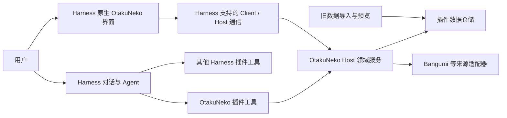

# OtakuNeko 的 DeepSeek Harness 原生插件开发计划

> 更新：2026-10-28　|　目标环境：DeepSeek Harness Desktop 0.2.1-rc.3，Windows x64　|　状态：开发中，搜索、日历和本地收藏待 Desktop 和真实网络验收

## 开发进展：原生功能切片

- 自查（2026-10-28）：alpha.14 的 30 项自动测试通过，覆盖收藏导入不覆盖、私密过滤、工作区和会话隔离、时间表并发保护及侧栏主要操作；隔离的 Harness profile 安装和启动、打包后代理查询已验证。真实 Bangumi 账号导入、Desktop 界面、真实对话中的工具调用与跨工作区隔离仍需验收。
- 已在 `integrations/deepseek-harness-native` 新建独立的原生插件开发包，保留已安装的 v0.1.3 原型及旧数据。
- Host 已实现 Bangumi 动画搜索、详情、每周放送日历和本地收藏服务，以及对应的只读 Harness 工具；Client 右侧栏可查询日历并编辑本地收藏的状态、进度、评分、标签、备注与私密标记。收藏存储使用 Harness Node 自带 SQLite；私密收藏和备注、标签不提供给 Agent 收藏查询工具。
- 24 项自动测试覆盖人设、收藏、凭据和代理设置的工作区隔离，按会话注册工具，以及旧人设数据保留。隔离的 rc.3 Web profile 曾验证 alpha.11 安装和 Host 启动；打包后的 Host 代码在测试作用域中通过本机代理真实查询 Bangumi。实际 Desktop 界面和跨工作区对话仍需验收。
- `0.2.0-alpha.11` 为工作区会话提供隔离的 Agent 工具、收藏数据库、Bangumi 凭据与代理配置；打开该工作区的 OtakuNeko 侧栏会启用工具。人设仍按工作区及会话 ID 绑定。旧全局收藏、账号凭据及人设数据保留但不会自动迁入新工作区，旧收藏迁移仍待实现。
- `0.2.0-alpha.12` 借鉴 bgm-cli 的收藏与剧集浏览体验，使用 Bangumi 官方 API 实现账号在线收藏的只读分页和 Agent 正片剧集查询。在线收藏仅通过已认证界面访问，不提供给 Agent，也不会自动同步或写入本地；真实账号及 Desktop 界面仍需验收。
- `0.2.0-alpha.13` 增加按工作区保存的手动每周观看时间表，可在侧栏创建、编辑、删除和标记私密；Agent 只查询非私密安排。时间为用户填写的本地时钟时间；旧时间表导入、时区换算、Bangumi 同步及导出仍未实现，Desktop 实际交互待验收。
- `0.2.0-alpha.14` 增加按页勾选 Bangumi 收藏导入、跳过现有项及本地收藏统计；Agent 统计排除私密收藏。增加当前工作区和会话隔离的显式记忆保存、查询和删除；暂不自动提取或注入，旧记忆导入、编辑和语义检索待实现。真实账号及 Desktop 交互待验收。
- `0.2.0-alpha.15` 支持本地收藏搜索、筛选、受控删除和 Agent 更新非私密收藏；从收藏预填独立观看安排并导出 ICS。两份 Skill 随包分发，需显式安装到目标项目工作区；自动会话注册尚待 rc.3 实际生命周期和隔离验证。
- `0.2.0-alpha.16` 对已启用 OtakuNeko 的工作区会话自动注册两份插件 Skill，使用 rc.3 的会话作用域，并在会话释放、插件卸载或下一次请求前发现工作区变化时清理。真实 rc.3 Skill 注册表和隔离测试通过；真实 Desktop 侧栏及模型加载仍需验收。bgm-cli 原始 Skill 依赖独立 CLI，且采用 AGPL-3.0，本版不直接打包。
- `0.2.0-alpha.17` 改为在 `DSH_HOME/otakuneko-native/shared-library.sqlite3` 保存共享本地收藏，已启用的 OtakuNeko 工作区使用同一数据库；时间表、凭据、人设和记忆作用域不变。各旧工作区收藏可逐一预览并明确合并，冲突跳过且旧库保持只读；原应用数据库和更早的全局原型数据尚未导入。Desktop 真实数据迁移待验收。
- `0.2.0-alpha.18` 增加角色、声优和制作人物/公司搜索及其关联动画查询，支持分页，声优结果展示角色、制作结果展示职务；界面与 Agent 共享服务，Desktop 实际交互待验收。
- `0.2.0-alpha.20` 增加 B 站搜索入口和基于 Bangumi ID、bangumi-data 的观看平台作品页查询，Agent 可调用同一服务。公开数据按需缓存；展示地区、来源和离线缓存状态，实际可播放情况由平台决定，Desktop 界面待验收。
- `0.2.0-alpha.21` 将会话中的 Agent 查询结果同步到右侧搜索页，并显示 Bangumi 封面和人物图片；临时结果按工作区和会话隔离，其他功能页面不会被切换。真实 Desktop 会话联动和图片网络加载待验收。
- `0.2.0-alpha.22` 将本地收藏、收藏统计和 Bangumi 收藏收拢到「收藏」栏目下，保留各自操作及数据来源。
- `0.2.0-alpha.23` 优化右侧栏的搜索、导航、封面卡片和收藏表单，使用原项目头像素材并适配窄栏及主题；Desktop 视觉效果待实际验收。
- 插件提供仅影响当前工作区的本机 HTTP 代理配置与测试入口。真实账号登录仍待验收。原 Agent 的观众口碑、基于条目标签的用户画像和旧记忆迁移仍待实现。
- Harness 默认本地凭据文件可由同一系统用户及其 Agent 进程读取；页面不向 Agent 工具输出令牌，也不声称可对本机进程隔离凭据。本地退出不撤销 Bangumi 端令牌。
- 收藏在同一 `DSH_HOME` 下共享；时间表、凭据等仍按工作区 ID 隔离，是否跨 profile 共用取决于工作区 ID 和 `DSH_HOME`。独立用户权限隔离尚未实现。

## 下一步优先顺序（alpha.14 自查后）

1. **真实环境验收**：在 Desktop 目标工作区验证连接 Bangumi、选择与导入收藏、查看统计和时间表；在同一工作区的两个会话及另一工作区验证人设和记忆隔离，再验证与其他插件同会话共存。记录发现的问题，不要求用户在聊天中提供令牌。
2. **旧数据导入**：只读检查旧 SQLite 并选择来源用户，预览收藏和时间表，按来源 ID 去重，事务导入并提供结果；旧数据库保持不变。角色和记忆另做格式与隐私评估。
3. **收藏与追番闭环**：补齐本地收藏删除、筛选；考虑从收藏创建时间表及日历导出。Bangumi 写回、同步冲突处理需先实现预览和授权边界。
4. **记忆改进**：实现查看后的编辑、搜索与可控的相关性召回；评估 Harness 的模型与对话扩展能力后再设计自动提取。当前记忆只在用户明确要求时保存，按需由 Agent 工具查询，不自动注入；令牌等敏感数据不应存入明文数据库。
5. **后续按需开发**：用户画像、观众口碑、OAuth 和 RSS/下载器等，根据实际使用价值与现有 Harness 插件能力决定；不重复实现 Harness 的模型、聊天和 Agent 调度。

## 目标与边界

把 OtakuNeko 的番组、收藏、时间表及相关功能迁移为 Harness 插件能力。Harness 提供 Agent、对话、模型和插件运行环境；OtakuNeko 插件提供领域服务、工具与界面，让同一会话可以组合使用其他 Harness 插件。模型账号和配置使用 Harness 已配置的提供方，不要求在 OtakuNeko 再填写模型 API Key。

插件在 Harness Host 中提供业务服务，Client 在 Harness 的扩展位置提供原生 React 界面。插件直接使用迁移后的领域逻辑、数据适配器和必要的第三方服务，不为此给原 OtakuNeko 应用新增 HTTP API。Client 与 Host 如需通信，使用 Harness 版本实际支持的通信机制；这里的 Harness 内部通信与 OtakuNeko 自建业务 HTTP API 是不同边界。Bangumi 等第三方接口及其可能需要的账号授权仍需单独处理，不能承诺完全没有第三方凭据。

首发以插件安装包交付，安装后无需用户另装 Python、Node、数据库或启动脚本。以 `0.2.1-rc.3` 的公开接口为基线，其他版本单独验证。原项目仍作为功能和数据来源；插件逐项迁移，不把 v0.1.3 自包含应用当作原生方案已完成。旧版安装和实现记录可在原项目的 `docs/plans` 目录查阅。

## 当前工程盘点

| 功能 | 现有位置与状态 | 原生插件迁移方向 |
| --- | --- | --- |
| 番组搜索、详情、放送日历 | `backend/app/services/bangumi_client.py`、`bangumi_service.py`、`subject_service.py` | Host 提供来源适配器和查询服务；暴露搜索、详情和日历工具 |
| 收藏与进度 | `backend/app/models/collection.py`、`services/collection_service.py`；收藏页 `frontend/src/app/collections` | Host 提供收藏仓储、查询和受控写操作；Client 实现收藏列表、详情和进度编辑 |
| 时间表 | `backend/app/models/schedule.py`、`services/schedule_service.py`；时间表页和 `components/timetable` | Host 处理星期、放送/观看时间、时长、同步；Client 实现周视图与编辑 |
| Bangumi 账号与授权 | 原应用填写 Bangumi 用户名以同步公开资料；原应用的本地登录并未验证 Bangumi 身份 | 增加 Harness 内的 Bangumi 账号授权、身份验证、凭据管理和退出；公开用户名查询单独保留并清楚标识 |
| Bangumi 同步、豆瓣导入 | `services/bangumi_service.py`、`services/douban_service.py`、收藏接口 | 先定义导入格式与预览，再提供显式执行、冲突处理和结果报告 |
| 日历/滴答清单导出 | `frontend/src/services/CalendarService.ts` 及导出弹窗 | 将可复用的导出逻辑与新 UI 解耦；验证其他日历插件的实际调用契约后再接入 |
| 统计与个人画像 | `services/stats_service.py`、`user_profile_service.py`，个人页 | 后续提供聚合服务、统计工具和可视化页面；以用户实际收藏为准 |
| RSS / qBittorrent | `services/qb_service.py`、`api/v1/rss.py`、智能订阅弹窗 | 作为可选适配器，先检查 Harness 已安装插件能力和授权方式，再决定接入方式 |
| 聊天、角色、模型选择与 Agent | `frontend/src/components/chat`、`backend/app/agents`、`backend/app/memory` | 由 Harness 对话、模型、Agent 和其他插件承接；保留业务相关内容与可迁移的数据需求清单 |
| 现有 Harness 原型 | `integrations/deepseek-harness/index.js` 和 `src/client.js` | 复用 bundle、client 注册和工具定义经验；当前两个工具依赖旧 HTTP 后端且默认关闭，不能计为原生能力 |

现有本地模式使用 SQLite，云模式支持 PostgreSQL；收藏和日程按 `user_id` 关联用户，收藏和日程都有 `user_id + source + source_id` 唯一约束。SQLite 的实际位置、数据量、用户选择和旧版 v0.1.3 是否产生过数据都需在导入时由用户选择或检查，不能假定某个路径就是唯一数据源。云端数据迁移另行设计。

## 目标架构

计划中的 Host 领域接口包括番组查询、收藏、日程、同步和导入导出。工具和 UI 共享同一服务，避免各自维护业务规则；跨插件协作通过 Harness 允许的工具、服务或事件机制实现，不能假定任意插件接口都可直接调用。

实现路线优先评估在 Harness 的 Node Host 中使用 TypeScript 重新实现或抽取领域逻辑，并通过接口隔离数据存储和第三方来源。现有 Python 服务包含 SQLModel、异步数据库会话和业务依赖，不能直接作为 Node 模块导入。若发现迁移成本或行为一致性存在重大问题，先做可复现的技术验证，再决定是否保留可封装的辅助进程；任何辅助进程都必须满足自包含安装和免手动启动的目标。具体数据库驱动、原生依赖与打包方式需在 rc.3 桌面运行时上验证后选定。

## Harness 内的新界面

rc.3 文档提供 `sidebarRightTabs.register`、右侧栏标签内容的 Slot 以及 Guide 入口。首选通过插件注册独立的 OtakuNeko 标签页，在 Harness 对话旁展示页面；无需先修改 Harness 核心。若需要更宽的布局、全局导航或现有扩展点无法承载的交互，先做 rc.3 可行性验证，并将需要修改上游界面的部分单独列为可选工作。参考 [右侧栏扩展](https://github.com/deepseek-ai/deepseek-harness/blob/dsh-v0.2.1-rc.3/docs/subsystems/sidebar-right.md)、[Slots](https://github.com/deepseek-ai/deepseek-harness/blob/dsh-v0.2.1-rc.3/docs/subsystems/slots.md)。

建议界面按同一个入口组织：

1. **概览**：今日/本周待看、近期更新和快捷搜索；空数据时给出导入或搜索入口。
2. **收藏**：搜索、筛选、状态、评分、进度和详情；变更有明确反馈。
3. **时间表**：周视图、放送/观看时间、时区、编辑与同步；保留拖拽作为后续增强，先保证键盘和表单可用。
4. **数据与设置**：Bangumi 账号连接和退出、授权状态、旧数据预览导入、同步状态、导出；模型设置使用 Harness 的已有入口。
5. **后续扩展**：个人统计、RSS 和下载器配置，按能力成熟度逐步加入。

新 UI 可借鉴现有 `MediaCard`、时间表和导出交互，但 Next.js 页面依赖路由、HTTP 服务和 Lobe/Ant Design 上下文，不能直接假定原样挂载。先抽取与框架无关的类型、格式化和纯展示组件，评估依赖体积、主题、字体、窄屏/暗色、键盘访问、加载/空/错误状态，再决定组件复用或重写。Client 不直接访问数据库、长期凭据或 Node 文件系统。

## 数据与兼容策略

- **默认方案待验证**：插件维护自己的版本化本地仓储，首次使用提供从旧 SQLite 导入的选择；不自动覆盖、不自动双向写入旧库。数据库驱动须验证 Harness Electron/Node ABI、Windows x64 安装、事务与打包。
- **导入流程**：用户选择源库和源用户，先只读检查 schema、生成预览和备份，再在事务中导入条目、收藏、日程及必要关联；按来源 ID 和用户映射处理重复与冲突，输出新增/跳过/失败数量。失败可重试，旧库保持原样。
- **并存边界**：完成导入后新插件数据与旧应用数据可能分叉；双向同步、并发写原库以及云端 PostgreSQL 不是首版默认行为，须先设计冲突策略和恢复方案。
- **身份与敏感数据**：明确 Harness profile 与旧 `users.id` 的映射；插件配置及来源授权由用户显式配置，避免将凭据、私密收藏和备注暴露到工具输出或日志。迁移不依赖旧版用户名免密 JWT。
- **写操作**：区分查询、单项修改、批量修改及删除；校验参数和用户身份。对批量覆盖、清空等高影响操作设计预览与用户确认；普通操作遵循 Harness 的实际授权与工具执行机制。

### Bangumi 账号授权与同步

- **账号连接是独立需求**：支持在 Harness 插件界面启动 Bangumi 账号授权，完成后通过 Bangumi 的 `/v0/me` 确认用户身份，展示已连接账号及失效状态。输入用户名查询公开资料只用于公开查询/导入，不能标记成已登录。
- **授权方式**：优先实现 Bangumi OAuth 2.0 授权码流程。按官方协议处理授权页面、随机 `state`、注册的回调地址、授权码换取令牌、有效期和刷新；验证 rc.3 Desktop 打开浏览器和接收回调的可行性。授权被拒绝、取消、回调不匹配、网络中断及令牌失效均有明确反馈。
- **应用注册前置条件**：Bangumi 官方换取和刷新令牌需要注册应用的 Client ID 与 Client Secret。先确定开发者的应用注册和桌面端安全交付方案，不把 Client Secret 硬编码进公开插件包，也不要求用户在聊天中提供任何密钥。是否支持用户自行创建的访问令牌作为可选连接方式，需在实现时确认体验和能力边界；不得把它标成已完成的 OAuth 登录。
- **凭据和生命周期**：使用 rc.3 Harness 的 `ctx.credentials` 持久化插件自己的授权记录，评估 `ctx.authorization` 的交互接入；令牌仅由 Host 按需使用，不放入模型上下文、普通配置、工具输出或日志。界面提供重新授权和本地退出，退出后删除本地凭据；只有验证 Bangumi 支持远端撤销时才声明远端已撤销。
- **账号映射和同步**：先关联已验证的 Bangumi 用户和插件本地用户，再提供收藏读取与导入预览。区分公开与私密数据；默认不向 Agent 暴露私密收藏、备注或令牌。写回 Bangumi 是独立能力，须明确授权范围、操作对象、冲突策略及用户确认，不能因登录自动覆盖云端数据。
- **验证**：使用模拟授权服务器与隔离凭据存储覆盖成功、拒绝、取消、过期、刷新失败、回调 `state` 不匹配、重启、换号、退出和日志脱敏。真实 OAuth、私密收藏及 Desktop 回调需在拥有已注册应用且能访问 Bangumi 的环境验收，测试前不索取用户密码或令牌。

## 里程碑与工作列表

### N0：确认扩展点与迁移设计

- [ ] 固定 rc.3 依赖版本，梳理 Host 工具注册、服务生命周期、Client 模块、Slot、右侧栏标签及 Client/Host 通信的公开契约；记录已验证与待验证项。
- [ ] 列出各功能输入输出、错误、缓存、用户作用域及现有依赖；盘点现有 SQLite schema 与需要导入的数据字段。
- [ ] 用最小原型验证自定义标签、Host/Client 通信和工具与其他插件同时启用；记录可复用的 rc.3 API 和限制。
- [ ] 比较 Node 原生实现与封装现有 Python 领域逻辑的成本、打包与维护风险，确定首版实现和本地数据库驱动。
- [ ] 确定旧版数据导入、身份映射及插件与旧版共存策略，保留 v0.1.3 回退路径。

**验收**：有可复现的扩展点样例和数据方案，安装与卸载不会修改旧应用数据。

### N1：原生插件骨架和只读能力

- [ ] 在现有 `integrations/deepseek-harness` 中重构出 Host、Client、领域类型、来源适配器和仓储边界；移除新路径对旧 HTTP 服务、端口 3000/8000 及自定义模型配置的依赖。
- [ ] 实现番组搜索、详情、放送日历的只读服务和 Harness 工具，处理分页、来源错误、超时与可读输出。
- [ ] 注册原生标签页和 Guide 入口，完成搜索、详情及加载/空/错误状态；验证主题、窄栏和键盘操作。
- [ ] 实现插件配置与必要的来源设置，不向对话返回密钥或多余的个人信息。
- [ ] 将工具接入 Harness 正常会话，与至少一个现有插件在同一会话中完成组合任务，验证启用、禁用和重载生命周期。

**验收**：安装插件后可在 Harness 内搜索番组、打开详情并在会话里使用工具；不启动 OtakuNeko 独立前后端，不额外配置模型 API Key。

### N1.5：Bangumi 账号连接

- [ ] 验证 rc.3 的授权交互、浏览器打开方式、Desktop 回调和 Harness 凭据存储；确定已注册 Bangumi 应用及安全交付方案。
- [ ] 实现 OAuth 授权码流程、`state` 校验、令牌换取与刷新，连接后用 `/v0/me` 确认身份。
- [ ] 在原生界面显示连接状态、账号信息、重新授权和本地退出；处理失败、取消、过期与换号。
- [ ] 在 Host 接入授权凭据和读取收藏的来源适配器；禁止将令牌及私密数据直接交给 Agent 或写入日志。
- [ ] 区分公开用户名同步与已授权账号；明确插件本地用户、旧应用用户和 Bangumi 身份之间的映射。

**验收**：用户能在 Harness 内完成真实 Bangumi 账号授权并看见正确账号；重启后凭据仍可用，退出可清除本地授权；错误、取消和无网络均有反馈，搜索等公开功能仍可用。

### N2：本地收藏与旧数据导入

- [ ] 选定并集成本地仓储，提供 schema 版本、迁移、事务、备份恢复和插件生命周期管理。
- [ ] 实现旧 SQLite 只读检查、用户选择、导入预览、去重、事务导入、报告与重试；准备覆盖旧 schema 变化的示例数据。
- [ ] 在账号已授权的情况下读取 Bangumi 收藏，支持分页、预览和显式导入本地；未授权时仅提供清楚标记的公开收藏查询。
- [ ] 实现收藏列表、搜索/筛选、详情、状态、评分、观看进度与单项修改工具；UI 和工具复用同一服务。
- [ ] 覆盖用户隔离、权限、私密字段、空库、重复导入、失败回滚与数据保留。

**验收**：从旧库导入后可在 UI 和会话查询同一收藏；修改后重启仍保留；旧库未被覆盖，失败可恢复。

### N3：时间表与放送同步

- [ ] 迁移星期、放送时间、观看时间、时长及来源标识，定义时区和跨日规则。
- [ ] 实现本周/指定日期查询、创建和更新日程工具；新增周视图、详情编辑和明确的同步反馈。
- [ ] 实现 Bangumi 日历同步预览、冲突处理和可重试执行；清空/批量覆盖先展示影响范围并确认。
- [ ] 按实际插件能力实现日历导出或跨插件交接，验证时间、时区和重复规则；拖拽、批量编辑作为增强。

**验收**：导入的时间表、UI 编辑和 Agent 查询一致；跨时区及失败同步不会悄然覆盖用户安排。

### N4：功能补齐与生态协作

- [ ] 按需求迁移 Bangumi 用户收藏同步、豆瓣导入、个人统计/画像及日历导出，逐项记录授权、冲突与错误处理。
- [ ] 调研其他 Harness 日历、下载器或通知插件的已安装接口；优先复用其能力，未安装或版本不匹配时显示清晰状态。
- [ ] 在需要时新增 RSS / qBittorrent 适配器与界面；明确用户授权、配置和失败行为。
- [ ] 选择至少两个跨插件场景验收，例如查询本周观看计划后交给用户已有的日历插件；实际调用以目标插件契约为准。

**验收**：目标功能有可追踪的迁移结果，跨插件场景能在同一 Harness 会话中完成并说明依赖条件。

### N5：安装、升级与交付

- [ ] 生成可通过 Harness 插件管理器/`dsh plugin add` 安装的包，包含 Host、Client 和必要运行依赖；在 Windows x64 干净环境验证自包含。
- [ ] 测试首次安装、启用/禁用、重启、升级、卸载、回退及用户数据保留；验证无固定端口冲突和无遗留进程。
- [ ] 检查 rc.3 client lazy-CJS 注册、依赖注入、扩展点生命周期与版本约束；升级到其他 Harness 版本需另做兼容验证。
- [ ] 提供使用与数据迁移文档、变更记录和包大小；发布到公共仓库前确认发布目标与授权。

**验收**：干净机器安装后，从 Harness 使用插件的核心工具、界面、收藏和时间表，无需额外运行时或手动启动服务。

## 优先开发顺序

1. **N0 技术验证**：确认 rc.3 原生标签、通信、工具、数据库驱动和旧数据映射。
2. **N1 纵向切片**：番组搜索 → Host 服务 → Harness 工具 → 原生详情 UI → 与其他插件同会话使用。
3. **N1.5 账号连接**：验证注册应用与回调 → Bangumi OAuth 登录和凭据管理 → 账号状态与退出。
4. **N2 数据闭环**：本地仓储 → 旧库只读预览与导入 → 授权收藏同步 → 收藏查询与编辑。
5. **N3 时间表闭环**：周视图、日程工具、Bangumi 同步及导出。
6. **N4/N5**：补齐其他功能，完成生态协作、安装、升级和交付验收。

## 待确定事项

- 首批界面希望更接近现有 OtakuNeko 的收藏/时间表视觉，还是优先贴合 Harness 默认样式？计划默认先适配 Harness 的布局和主题，保留现有信息架构。
- 实际需要导入哪个旧数据库、选择哪个旧用户；是否涉及 PostgreSQL 云端数据？这些应在实现导入时按用户的实际数据确定。
- Bangumi OAuth 应用由谁注册、桌面端回调地址如何配置，以及 Client Secret 如何安全交付；实现前需要验证，不在仓库或聊天中存放真实密钥。
- 需要优先联动哪些已安装插件？应逐个确认其工具、服务、权限和版本契约。
- `0.2.1-rc.3` 的 Client/Host 通信方式、数据库驱动打包以及右侧栏宽度体验需要通过 N0 原型确认，当前只是设计方向。

## 参考资料

- [Harness rc.3 右侧栏扩展](https://github.com/deepseek-ai/deepseek-harness/blob/dsh-v0.2.1-rc.3/docs/subsystems/sidebar-right.md)
- [Harness rc.3 Slots](https://github.com/deepseek-ai/deepseek-harness/blob/dsh-v0.2.1-rc.3/docs/subsystems/slots.md)
- [Harness rc.3 Client Modules](https://github.com/deepseek-ai/deepseek-harness/blob/dsh-v0.2.1-rc.3/docs/subsystems/client-modules.md)
- [Harness rc.3 bundle 发布与安装](https://github.com/deepseek-ai/deepseek-harness/blob/dsh-v0.2.1-rc.3/docs/user/develop/basic/publish.md)
- [Harness rc.3 凭据服务](https://github.com/deepseek-ai/deepseek-harness/blob/dsh-v0.2.1-rc.3/packages/credentials/credentials/README.md)和 [授权交互](https://github.com/deepseek-ai/deepseek-harness/blob/dsh-v0.2.1-rc.3/packages/credentials/authorization/README.md)
- [Bangumi 用户授权机制](https://github.com/bangumi/api/blob/master/docs-raw/How-to-Auth.md)和 [Bangumi API 规范](https://github.com/bangumi/api/blob/master/open-api/v0.yaml)
